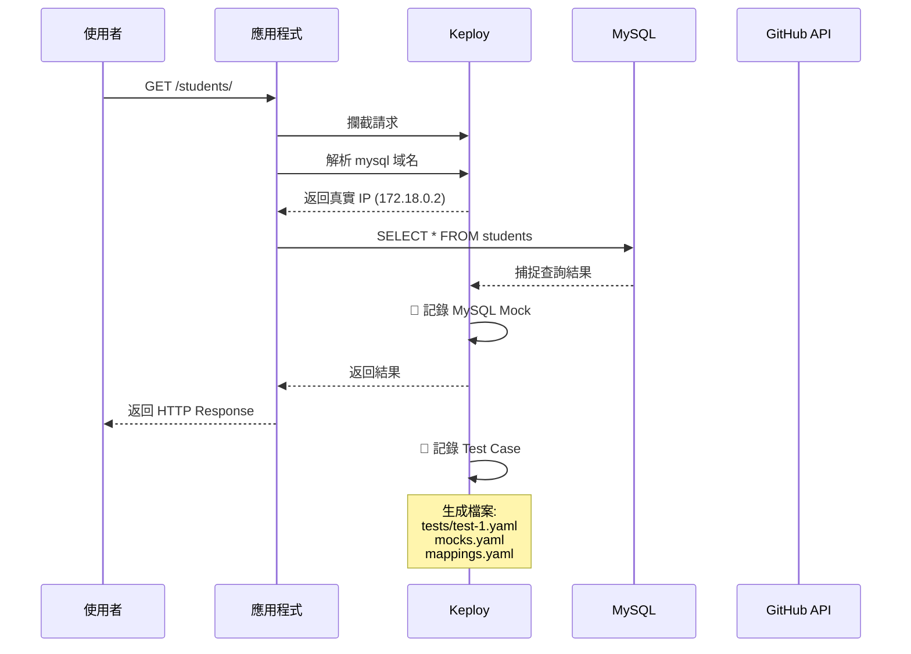
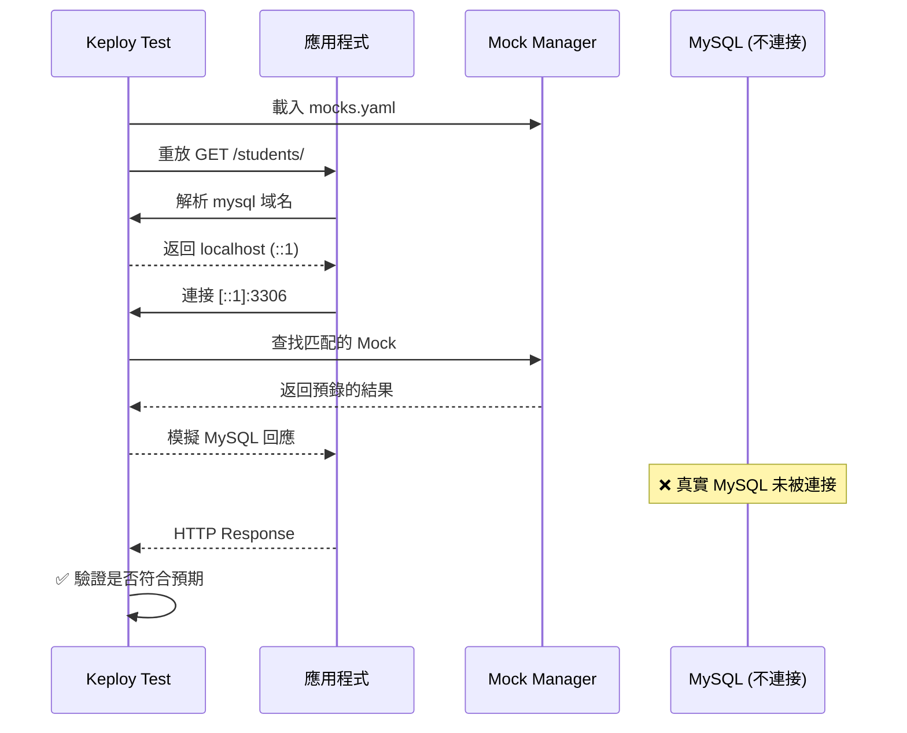
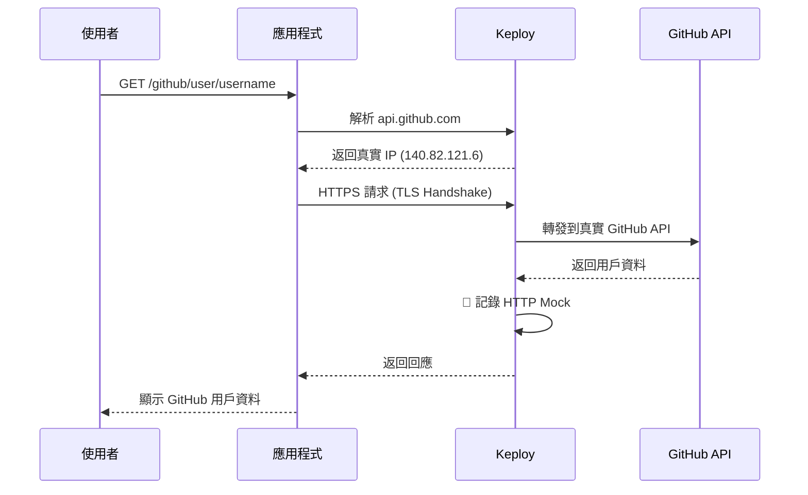
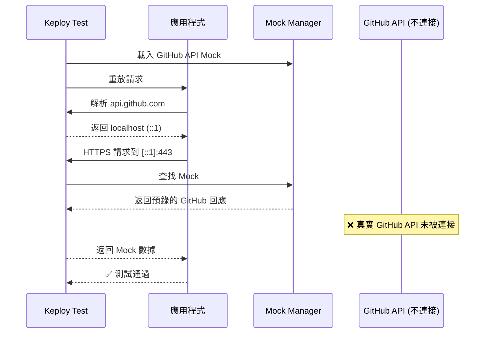

# Keploy 使用指南

> 本文檔說明 Keploy 的核心功能、運作流程，以及使用限制。

---
## 1. Keploy 介紹

### 什麼是 Keploy？

**Keploy** 是一個 API 測試自動化工具，透過 **eBPF** 技術在 Linux kernel 層攔截應用程式的網路流量，**無需修改程式碼**即可：

- 自動錄製 API 請求與回應
- 自動產生測試案例
- 自動 Mock 外部依賴（Database、Third-party APIs）
- 自動回放測試並驗證結果

### 架構概覽

```
使用者
  ↓
應用程式
  ↓
eBPF Hooks (攔截所有網路流量)
  ↓
Keploy Proxy + DNS Server
  ↓
外部依賴 (MySQL / External APIs)
```

**關鍵組件**：
- **eBPF Hooks**：在 kernel 層攔截所有網路流量
- **Proxy Server**：處理 TLS、協議解析、Mock/Record 邏輯
- **DNS Server**：控制域名解析
  - Record Mode：返回真實 IP
  - Test Mode：返回 localhost
- **Mock Manager**：儲存和匹配 Mock 數據

---

## 2. Record Mode 錄製流程

### 目的

捕捉應用程式的真實行為，生成測試案例和 Mock 數據。

### 運作流程



### 關鍵行為

1. **DNS 解析**：返回**真實 IP**
   - MySQL: `172.18.0.2`
   - GitHub API: `140.82.121.6`


3. **自動記錄**：
   - HTTP 請求/回應 → `tests/test-*.yaml`
   - 外部依賴互動 → `mocks.yaml`
   - 對應關係 → `mappings.yaml`


---

## 3. Test Mode 測試流程

### 目的

在隔離環境中驗證應用行為，使用錄製的 Mock 模擬外部依賴。

### 運作流程（使用 Mock）



### 關鍵行為

1. **DNS 解析**：返回 **localhost** (`::1` 或 `127.0.0.1`)
   - 所有外部域名都解析為 localhost
   - 確保流量被 Keploy 攔截

2. **Mock 匹配**：從 `mocks.yaml` 找到對應的預錄結果

3. **隔離測試**：不連接任何真實外部服務

4. **結果驗證**：比對 Status Code、Headers、Body

---

## 4. MySQL 測試流程

### 4.1 使用 Mock（推薦）

**運作流程**：
```
應用 → DNS 查詢 mysql → Keploy 返回 localhost
    → 攔截 MySQL 連接 → Mock Manager 返回預錄結果
    → ✅ 測試通過（不連接真實 MySQL）
```

**特點**：
- ⚡ 快速（無網路延遲）
- 🔒 隔離（不依賴 Database 狀態）
- 🔁 可重複（每次結果一致）

---

### 4.2 不使用 Mock（--no-mocking）

**運作流程**：
```
應用 → DNS 查詢 mysql → Keploy 返回 localhost (::1)
    → 嘗試連接 [::1]:3306 → ❌ Connection refused
```

**失敗原因**：

| 問題 | 說明 |
|------|------|
| DNS 限制 | Test Mode 的 DNS 始終返回 localhost |
| 地址錯誤 | 真實 MySQL 在 `172.18.0.2:3306`，但應用連到 `[::1]:3306` |
| 無服務 | localhost:3306 沒有 MySQL 服務運行 |

**結論**：`--no-mocking` 對 MySQL 預設**不會成功**，除非在本機運行 MySQL。

---

## 5. External API 測試流程

### 5.1 Record Mode（錄製外部 API）

**流程圖**：



**關鍵步驟**：
1. DNS 返回**真實 IP** (`140.82.121.6`)
2. Keploy 使用 CA 證書攔截 HTTPS
3. 轉發請求到真實 GitHub API
4. 記錄完整的 Request/Response

---

### 5.2 Test Mode（使用 Mock）

**流程圖**：



**特點**：
- ✅ 使用預錄的 GitHub API 回應
- ✅ 不需要網路連接
- ✅ 測試快速且穩定

---

### 5.3 Test Mode 嘗試連接真實 API（失敗）

**流程**：
```
應用 → DNS 查詢 api.github.com → Keploy 返回 localhost (::1)
    → 嘗試 HTTPS 請求到 [::1]:443
    → ❌ Connection refused
```

**為什麼 `--global-passthrough` 無效？**

| 階段 | 行為 | 結果 |
|------|------|------|
| DNS 解析 | 返回 localhost (`::1`) | ❌ 不是真實 IP |
| Proxy 檢查 | GlobalPassthrough = true | ✅ 允許通過 |
| 連接嘗試 | 嘗試連接 `[::1]:443` | ❌ Connection refused |

**核心問題**：
- DNS 層已經返回錯誤的地址（localhost）
- Proxy 層的 `--global-passthrough` 無法修正 DNS 錯誤
- localhost:443 沒有服務運行

---

## 6. 功能限制說明

### 關鍵限制

| 限制 | 說明 |
|------|------|
| **Test Mode 無法連接真實外部 API** | DNS 層在 Test Mode 始終返回 localhost，無法繞過 |
| **`--global-passthrough` 對外部 API 無效** | Proxy 收到的地址已是 localhost，無法連接真實服務 |
| **`--no-mocking` 對 MySQL 預設失敗** | 同樣的 DNS 限制，除非在本機運行 MySQL |

### 模式對照表

| 場景 | Record Mode | Test Mode (with Mock) | Test Mode (without Mock) |
|------|-------------|----------------------|-------------------------|
| **MySQL** | ✅ 連接真實 DB | ✅ 使用 Mock | ❌ 預設失敗 |
| **外部 HTTPS API** | ✅ 連接真實 API | ✅ 使用 Mock | ❌ 無法連接 |
| **DNS 解析** | 真實 IP | localhost | localhost |
| **速度** | 慢 | 快 | 慢 |
| **穩定性** | 依賴外部服務 | 穩定 | 依賴外部服務 |
| **適用場景** | 錄製測試案例 | CI/CD、單元測試 | 不適用 |

### 設計理念

Keploy 的 Test Mode 設計為**完全隔離的測試環境**：

- ✅ Record Mode = 開放環境，連接真實服務
- ✅ Test Mode = 封閉環境，使用 Mock
- ❌ Test Mode 不支援連接真實外部服務

---

## 7. 常見問題

### Q1: 為何 Test Mode 無法連接真實外部 API？

**原因**：
- Keploy 的 Test Mode 設計為完全隔離的測試環境
- DNS 層在 Test Mode 始終返回 localhost
- 即使使用 `--global-passthrough`，DNS 已返回錯誤地址
- 這是刻意的設計，確保測試不依賴外部網路

**解決方法**：接受此限制，使用 Mock 進行測試

---

### Q5: Keploy 支援哪些外部依賴？

**Database**：
- ✅ MySQL
- ✅ PostgreSQL
- ✅ MongoDB
- ✅ Redis
- ✅ SQL Server

**協議**：
- ✅ HTTP/HTTPS
- ✅ gRPC（基礎支援）
- ⚠️ WebSocket（不支援長連接）
- ⚠️ gRPC Streaming（部分支援）

---

## 總結

### Record Mode vs Test Mode

| 模式 | DNS 行為 | 外部連接 | 用途 |
|------|---------|---------|------|
| **Record** | 返回真實 IP | ✅ 連接真實服務 | 錄製測試案例和 Mock |
| **Test (Mock)** | 返回 localhost | ❌ 使用 Mock | 隔離測試、CI/CD |
| **Test (No Mock)** | 返回 localhost | ❌ 預設失敗 | 不適用 |

### 核心原理

```
Record Mode：
  DNS 返回真實 IP → 連接真實服務 → 記錄互動

Test Mode：
  DNS 返回 localhost → 攔截流量 → Mock Manager 返回預錄數據
```

### 最佳實踐

1. **使用 Record Mode** 錄製所有需要的場景
2. **使用 Test Mode with Mock** 進行快速、穩定的測試
3. **接受設計限制**：Test Mode = 完全隔離環境
4. **整合測試**：如需連接真實服務，考慮其他測試工具

---

## 參考資源

- [Keploy 官方文檔](https://keploy.io/docs/)
- [GitHub Repository](https://github.com/keploy/keploy)
